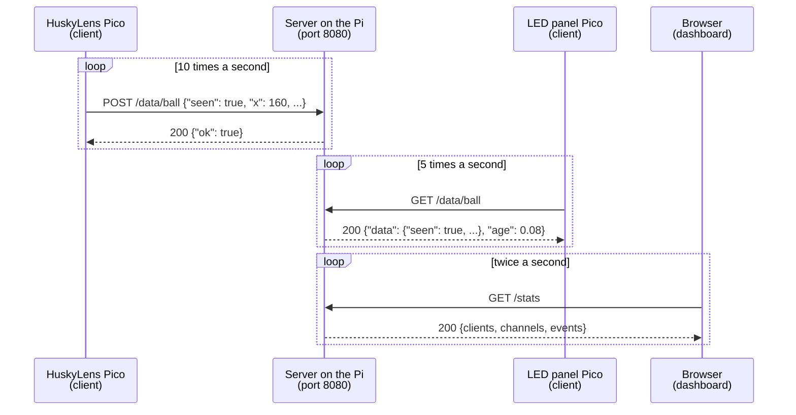

# The Goal-line Lab protocol

This is the **contract** between the three roles. As long as everyone sticks to it, the server, the camera Pico and the LED panel Pico can be built at the same time by different people and will still work together.



- All messages are **HTTP** over **TCP/IP** on port **8080**, carrying **JSON**.
- The server just stores the **latest** value on each **channel**. It doesn't know or care what the data means.
- The clients **poll**: the server never contacts a Pico first.

## Channels
A channel is a named slot on the server, like a variable that every device can read and write. A channel name is 1 to 32 characters long, using only letters, digits, `_` or `-`, for example `ball`.

## Endpoints

| Method and path | Request body | Response (status 200) | Stage |
|---|---|---|---|
| `GET /` | - | the `dashboard.html` web page | Server 1 |
| `GET /data/<channel>` | - | `{"data": <latest JSON>, "age": <seconds>}` or `{"data": null, "age": null}` if nothing has been sent yet | Server 2 |
| `POST /data/<channel>` | any JSON | `{"ok": true}` | Server 3 |
| `GET /data` | - | `{"<channel>": {"data": ..., "age": ...}, ...}` for every channel | Server 4 |
| `GET /stats` | - | see [/stats](#get-stats) | Server 5 |

`age` is the number of seconds since that channel was last written, rounded to 2 decimal places.

### Errors
| Status | When | Body |
|---|---|---|
| 400 Bad Request | a POST body isn't valid JSON (the stored data must not change) | `{"error": "invalid JSON"}` |
| 404 Not Found | any other path | `{"error": "not found"}` |
| 413 Payload Too Large | a POST body is over 4096 bytes (extension) | `{"error": "too large"}` |

### Headers
- Clients send `Content-Type: application/json` with every POST.
- Clients send **`X-Pico-Name: <device name>`** (for example `huskylens` or `led_panel`) with every request, so the server can show who is who. `PicoComs(name="...")` does this for you.

## The `ball` channel

The HuskyLens Pico writes and the LED panel Pico reads.

```json
{"seen": true, "x": 160, "y": 120, "w": 64, "h": 60, "id": 1}
```
```json
{"seen": false}
```
| Field | Meaning |
|---|---|
| `seen` | `true` if the ball is in view |
| `x`, `y` | **centre** of the ball's box on the camera image (0-319, 0-239; (0, 0) is the top-left) |
| `w`, `h` | width and height of the box in camera pixels |
| `id` | the ID the HuskyLens learned the ball as (1) |

**Staleness rule:** if `age` is more than **2 seconds**, the camera Pico has stopped sending. Treat the camera as **offline**, whatever `seen` says.

## GET /stats

This is the Server stage 5 extension. It powers the CLIENTS and EVENTS panels on the dashboard.

```json
{
  "uptime": 754,
  "clients": [
    {"name": "huskylens", "ip": "192.168.1.23", "age": 0.05, "rate": 9.8,
     "posts": 7310, "gets": 0, "errors": 0}
  ],
  "channels": [
    {"name": "ball", "age": 0.05, "rate": 9.8, "updates": 7310,
     "data": {"seen": false}}
  ],
  "events": [[1791990018.2, "new client huskylens (192.168.1.23)"]]
}
```
| Field | Meaning |
|---|---|
| `uptime` | seconds since the server started |
| `clients` | one entry per client IP address. `name` comes from `X-Pico-Name`, `age` is the seconds since its last request, `rate` is its requests per second over the last 5 s, `posts`/`gets` are totals, and `errors` counts requests that didn't get a 200 |
| `channels` | one entry per channel. `rate` is updates per second over the last 5 s, and `updates` is the total |
| `events` | the latest 20 or so `[unix time, text]` pairs, such as new clients, new channels and errors |

Only requests to `/data/<channel>` count towards client stats. The dashboard's own requests are left out.

## Using it from a Pico: `PicoComs`
`pico_lib/pico_coms.py` wraps the protocol so the Pico code stays short:
```python
from pico_coms import PicoComs
coms = PicoComs(name="huskylens")   # Wi-Fi details and SERVER_URL come from settings.toml
coms.connect()
coms.send("ball", {"seen": False})  # True if the server replied 200
data = coms.get("ball")             # the data, {} if nothing sent yet, None if unreachable
coms.age                            # the "age" from that get()
coms.last_error                     # why the last send/get failed
```

## Trying it by hand
```bash
curl http://<server-ip>:8080/data/ball
```
```bash
curl -X POST -H "Content-Type: application/json" -d '{"seen": false}' http://<server-ip>:8080/data/ball
```
